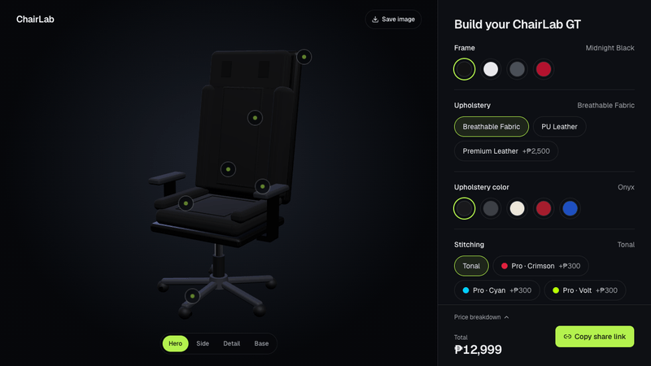
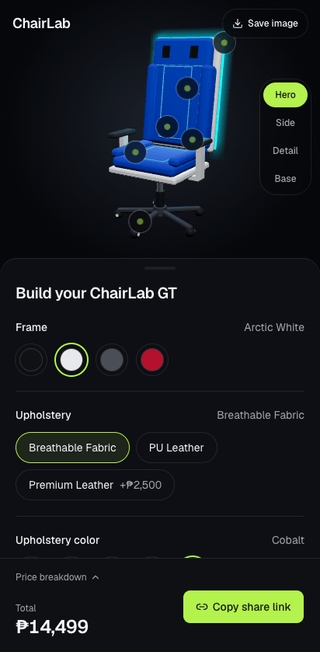

# ChairLab

A mobile-first 3D gaming chair configurator. Orbit, rotate and zoom a chair; swap frame, upholstery, stitching, base, lumbar pillow and RGB; watch the price update live; share your build by URL or short id. No login required.

> Status: **Phase 6 — Polish and launch.** See [docs/PROGRESS.md](docs/PROGRESS.md).





## Highlights

- Orbit, zoom and camera presets (Hero, Side, Detail, Base); hotspots jump to the matching option
- Live price in integer centavos with a per-option breakdown; the server recomputes it on save
- Share by long URL or a short, content-addressed `/b/<id>` link; no login
- Falls back to a flat SVG preview without WebGL; reduced motion turns off auto-spin and the RGB pulse
- Interactive in under 2 s on a throttled mid-range phone profile (see [Performance](docs/PROGRESS.md#phase-6--polish-and-launch))

## Stack

- **App:** Next.js (App Router) + TypeScript — the only public entry (BFF via Route Handlers)
- **UI:** Tailwind CSS v4, shadcn/ui; motion is CSS transitions gated by `prefers-reduced-motion` (Framer Motion wasn't needed)
- **3D:** three, @react-three/fiber, @react-three/drei, lazy-loaded; procedural chair (a GLB swap would use Draco, see [docs/MODEL.md](docs/MODEL.md))
- **State/validation:** Zustand, Zod
- **Data:** Supabase Postgres via the BFF only (PostgREST over `fetch`, service role server-side; RLS denies the public keys)
- **Tests:** Vitest (domain), Playwright (UI), Cucumber.js + Playwright (BDD)
- **Hosting:** Vercel
- **Testing extras:** axe-core (WCAG audit in Playwright), sharp (README GIF encoding)

## Getting started

Requires Node 24 (see `.nvmrc`).

```bash
npm install
cp .env.example .env.local   # set CONFIG_STORE=memory to run without Supabase
npm run dev
```

### Saved builds (Supabase)

1. Create a Supabase project and apply `supabase/migrations/*.sql` (SQL editor, or `supabase db push` with the CLI).
2. Set `SUPABASE_URL` and `SUPABASE_SERVICE_ROLE_KEY` (server-only) in `.env.local` / Vercel.
3. Without them, `/api/configs` returns 503 and "Copy share link" falls back to the long URL.

### Deploy (Vercel)

1. Import the GitHub repo in Vercel (framework: Next.js; Node 24 comes from `engines`). No build settings to change.
2. In Supabase, create the project in the region nearest your users (e.g. Singapore for PH) and apply the migration.
3. In Vercel → Settings → Environment Variables, set `SUPABASE_URL` and `SUPABASE_SERVICE_ROLE_KEY` for Production and Preview. Optionally set `NEXT_PUBLIC_SITE_URL` to your custom domain.
4. In Vercel → Settings → Functions, set the region to match Supabase (e.g. `sin1`) so saves don't cross oceans.
5. Deploy, then open the site, press **Copy share link** and open the copied `/b/<id>` link.

`CONFIG_STORE=memory` is refused on Vercel production, so a missing Supabase config fails loudly (503) instead of silently losing builds.

### API

`POST /api/configs` `{ "config": {...} }` → `201 { id, path: "/b/<id>", totalCentavos }`.
`GET /api/configs/<id>` → the saved build (immutable, cacheable). `/b/<id>` opens it in the configurator.

## Scripts

| Script | What it does |
| --- | --- |
| `npm run dev` | Dev server on http://localhost:3000 |
| `npm run build` / `npm start` | Production build / serve |
| `npm run lint` | ESLint |
| `npm run typecheck` | Generate route types + `tsc --noEmit` |
| `npm test` | Vitest unit tests |
| `npm run test:e2e` | Playwright (desktop + mobile); starts a server if none is running |
| `npm run test:bdd` | Cucumber features; needs a server on `BASE_URL` (default `http://localhost:3000`) |
| `npm run media` | Re-record `docs/media/*.gif` and the link-preview image; needs a server on `BASE_URL` |
| `psql -v ON_ERROR_STOP=1 -f supabase/tests/configs_rls.sql` | Migration + RLS checks on any scratch Postgres (rolled back) |

First Playwright run: `npx playwright install chromium`. E2E uses `CONFIG_STORE=memory` (set automatically when Playwright starts the server; set it yourself if you start one).

## Project layout

```
src/app/                    routes + Route Handlers
src/components/ui/          shadcn/ui primitives
src/components/chair-scene/ 3D scene, flat fallback, camera presets, hotspots
src/components/configurator/ configurator shell, option panel, price bar
src/lib/configurator/       domain: catalog types, price rules, URL serialize, validation, share id
src/services/configs/       saved builds: repository port, Supabase + in-memory adapters, API handlers
src/data/catalog.ts         catalog + prices in integer centavos
supabase/                   migrations + SQL tests
scripts/                    capture-media.mts (README GIFs, link-preview image)
e2e/                        Playwright specs
features/                   Cucumber features + steps
docs/                       PROGRESS.md, MODEL.md, media/
```

## Conventions

- Money is integer centavos everywhere. Never floats.
- Secrets live in env vars only; `.env.example` lists names, never values.
- One phase per PR; PRs are reviewed and merged by a human.

## Credits

The chair is a procedural model built in code (no third-party asset). See [docs/MODEL.md](docs/MODEL.md).
